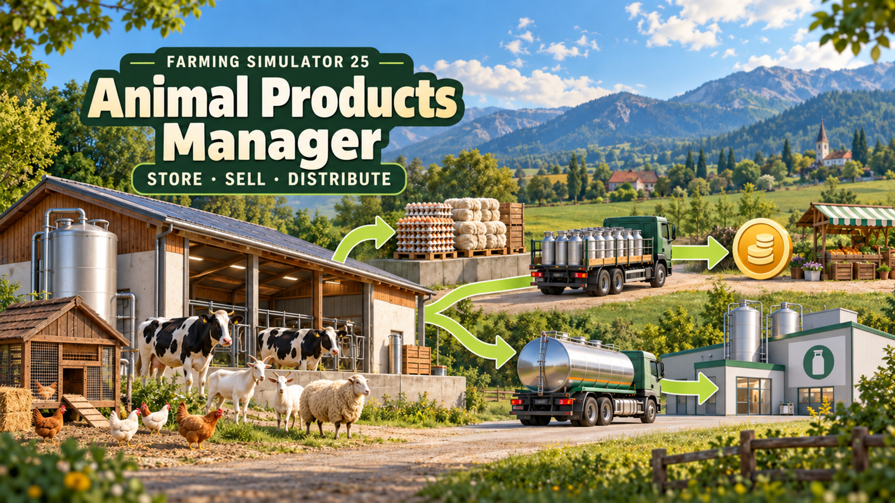

# Animal Products Manager · 动物产品管理

## English

Version 1.0.0.0 · Farming Simulator 25 1.24 (PC)

Choose what happens to each product of your husbandries, such as milk, goat milk, eggs and wool: keep storing it, sell it automatically, or deliver it to your own production points. Products are read from each barn, so every animal that produces them is supported.

### How to use

1. Open the Animals page of the in-game menu and select a husbandry.
2. Click **Product destinations**.
3. Pick a mode for each product and confirm. Cancel leaves everything unchanged.

The list shows what the animals in that barn produce: goats only shows goat milk, sheep only shows wool. Young animals or a pause in production don't hide a product, so you can set it in advance. Reopen the dialog after your animals change. A barn whose animals produce nothing has no button. Settings for products you no longer produce are kept and apply again when you keep those animals again.

| Mode | What happens |
| --- | --- |
| Storing (default) | Same as the base game: the tank fills and pallets appear. |
| Selling | Once per in-game hour, the stock is sold at the current price times the game's automatic-sale rate (90%). |
| Distributing | Once per in-game hour, the stock goes to your farm's production points that accept it, split by their free space. The game's normal delivery fee applies. |

Good to know:

- Distributing only delivers to your own farm. If nothing accepts the product or there is no space left, the rest stays in the barn. Production points accept goods even while their production is paused, as in the base game.
- Liquids are taken from the barn's own tank, not from other storage connected to it.
- For pallet products, only output that hasn't become a pallet yet is handled. Pallets already on the ground or on trailers stay where they are and need manual transport. Right after you switch modes, a pallet that was already on its way may still appear empty.
- Switching back to Storing makes pallets appear again. With a large backlog they may wait for free space or the pallet limit.
- Feed, animal health and production are unchanged. Tank capacity still applies.
- When a barn changes owner, all of its products go back to Storing.

Multiplayer:

- Everyone needs the same version of the Mod.
- Farm members allowed to trade animals can change the settings. Settings are saved per barn and product, and players who join later receive them.
- If two managers change the same product, the last change wins. Different products are saved separately. An open dialog doesn't refresh: reopen it to see what others changed. Rows you didn't touch never overwrite someone else's choice.
- Only the server sells and delivers, so nothing is counted twice.

The Mod doesn't handle manure, slurry, animal trading or DLC-specific outputs. Third-party husbandries with their own storage or pallet handling, and other Mods that sell or deliver the same products automatically, may not work together with it; try them in a separate save first.

### Install and update

Put `FS25_AnimalProductsManager.zip` in `Documents\My Games\FarmingSimulator2025\mods` and activate the Mod when you load a save. To update, replace the old ZIP with the new one; your settings are kept.

### Uninstall

Switch every barn back to Storing, let one in-game hour pass so the pallets appear, then save. If the game log contains `retained ... liters ... for recovery`, some product couldn't go back into the barn and the Mod is holding it: keep the Mod active, free up space and let another in-game hour pass before you uninstall, or that product is lost.

### License

MIT License, see [LICENSE](LICENSE).

## 中文

版本 1.0.0.0 · 模拟农场 25 1.24（PC）

为畜舍的每种产品（如牛奶、山羊奶、鸡蛋、羊毛）选择去向：继续储存、自动出售，或送往自己农场的生产点。产品按畜舍自动识别，所有产出这些产品的动物都适用。

### 使用方法

1. 打开游戏菜单的“动物”页面，选择畜舍。
2. 点击“产品去向”。
3. 为每种产品选择挡位后确认。取消不会修改任何设置。

列表显示该畜舍动物实际产出的产品：只养山羊显示山羊奶，只养绵羊显示羊毛。幼龄动物或暂时停产不会隐藏产品，可以提前设置。动物变化后重新打开弹窗即可刷新。动物没有任何产出的畜舍不显示按钮。不再产出的产品会保留原设置，再次饲养对应动物时重新生效。

| 挡位 | 效果 |
| --- | --- |
| 储存（默认） | 与原版相同：储罐蓄积，生成托盘。 |
| 出售 | 每游戏小时按当前价格乘游戏自动出售比例（90%）卖出库存。 |
| 分配 | 每游戏小时把库存送往本农场接收该产品的生产点，按各自空余容量分配，按原版规则收取运费。 |

注意事项：

- 分配只送往自己农场。没有接收设施或容量不足时，剩余产品留在畜舍。与原版一致，生产点暂停生产时仍可接收货物。
- 液体只处理畜舍自身储罐，不抽取连接到畜舍的其他仓储。
- 托盘类产品只处理尚未生成托盘的产出；地上或拖车上已有的托盘保持原样，需要手动运输。刚切换挡位时，已经在生成中的托盘可能是空的。
- 切回储存后会重新生成托盘；积压较多时，可能需要等待空位或托盘数量上限。
- 饲料、动物健康和产量不受影响，储罐容量限制照常生效。
- 畜舍更换所有者后，所有产品恢复为储存。

多人游戏：

- 所有玩家需要安装同一版本。
- 有动物交易权限的农场成员可以修改设置。设置按畜舍和产品保存，之后加入的玩家也会同步。
- 两位经理修改同一产品时，以最后一次修改为准；不同产品分别保存。已打开的弹窗不会自动刷新，重新打开才能看到他人的修改；你没有改动的行不会覆盖他人的设置。
- 出售和分配只由服务器处理，不会重复结算。

本 Mod 不处理粪肥、粪浆、动物交易或 DLC 专属产出。自带库存或托盘处理的第三方畜舍，以及自动出售或分配同类产品的其他 Mod，可能无法与本 Mod 共用，请先在单独的存档中试用。

### 安装与更新

把 `FS25_AnimalProductsManager.zip` 放进 `文档\My Games\FarmingSimulator2025\mods`，载入存档时勾选本 Mod。更新时用新 ZIP 替换旧 ZIP，原有设置保留。

### 卸载

先把所有畜舍切回储存，等待一个游戏小时让托盘生成，再保存。如果游戏日志中出现 `retained ... liters ... for recovery`，说明有产品无法退回畜舍，暂由本 Mod 保管：请保持 Mod 启用，腾出空间并再等待一个游戏小时后再卸载，否则这部分产品会丢失。

### 许可

MIT 许可，见 [LICENSE](LICENSE)。
