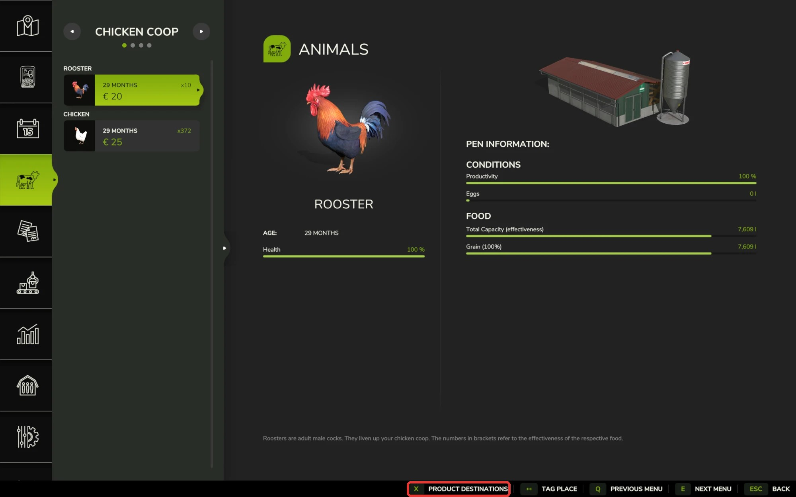
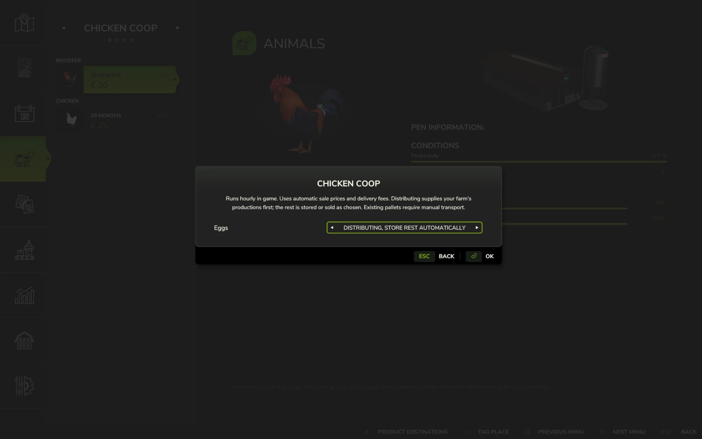
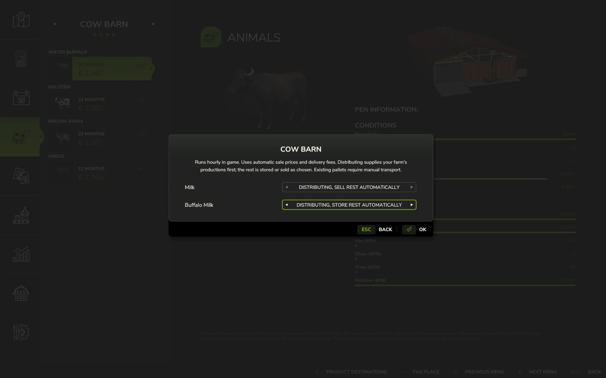

# Animal Products Manager · 动物产品管理

  
  
  
  
  

  <a href="#english">English</a> · <a href="#中文">中文</a>

## English

Version 1.0.0.4 · Farming Simulator 25 1.25 (PC)

**Download:** [GitHub release 1.0.0.4](https://github.com/martin-lzh/farming-simulator-25-mods/releases/tag/animal-products-manager-v1.0.0.4) (`FS25_AnimalProductsManager.zip` under **Assets**) · [Nexus Mods](https://www.nexusmods.com/farmingsimulator25/mods/220)

Your barns keep filling tanks and stacking pallets of milk, eggs and wool that you have to haul away by hand. With this Mod you choose, for each product of each barn, what happens to it: keep storing it, sell it automatically every in-game hour, or deliver it to your own production points and then store or sell whatever is left. It works for every barn whose animals produce milk, goat milk, buffalo milk, eggs, wool or similar products.

### How to use

1. Open the in-game menu, go to the **Animals** page and select a barn.
2. Click **Product destinations** in the bottom bar, or press the key shown next to it.

   

3. The dialog lists each product the animals in that barn produce. Pick a mode for each product.

   

4. Press **OK** to save. **Back** closes the dialog without changing anything.

A barn with several products shows one row for each, and each row has its own mode:

The list matches the animals in the barn: goats only show goat milk, sheep only show wool. Young animals or a pause in production don't hide a product, so you can set it in advance. When the animals in a barn change, reopen the dialog to see the new list. A barn whose animals produce nothing has no Product destinations button. If you stop keeping an animal, its product's setting is kept and applies again when you keep that animal again.

### Modes

| Mode | What happens |
| --- | --- |
| Storing (default) | Same as the base game: the tank fills and pallets appear. |
| Selling | Once per in-game hour, the stock is sold at the current price times the game's automatic-sale rate (90%). |
| Distributing, store rest automatically | Once per in-game hour, the stock goes to your farm's production points that accept it, split by their free space. The game's normal delivery fee applies. Whatever doesn't fit is stored as in Storing: milk stays in the tank, and eggs, wool and other pallet products become pallets. |
| Distributing, sell rest automatically | Delivers the same way, then sells whatever doesn't fit at the same price as Selling. If none of your production points accepts the product, everything is sold. |

### Good to know

- Distributing only delivers to production points of your own farm. As in the base game, a production point accepts goods even while its production is paused.
- Milk is taken only from the barn's own tank. Other storage connected to the barn is left alone.
- Pallets that are already on the ground or on a trailer stay where they are; transport them by hand. Right after you switch modes, a pallet that was already being filled may still appear empty.
- With Distributing, store rest automatically, new eggs and wool wait in the barn until the next in-game hour so they can be delivered first. Only what is left then becomes pallets.
- When you switch back to Storing, pallets appear again. With a large backlog, some may wait until there is free space or you are below the pallet limit.
- Feed, animal health and production stay the same. The tank keeps its normal capacity.
- When a barn changes owner, all of its products go back to Storing.
- Manure, slurry, animal trading and DLC-specific outputs are not handled.
- Barns from other Mods that handle their own storage or pallets, and other Mods that also sell or deliver animal products automatically, may not work together with this Mod. Try the combination in a separate save first.
- Distribution Redux by Bones also handles animal products, as part of a farm-wide distribution network. You can use both: products you set to Selling or Distributing here are handled by this Mod first, and Distribution Redux works with what is left. Pallets then follow Distribution Redux's pallet setting, which by default only puts out full pallets. Manage each product in one Mod only and leave it on Storing (or Hold) in the other; if both distribute the same product, you pay both delivery fees.

### Multiplayer

- Everyone needs the same version of the Mod.
- Farm members who are allowed to trade animals can change the settings. Players who join later get the current settings.
- Settings are saved per barn and per product. If two players change the same product, the last change counts; changes to different products don't affect each other.
- An open dialog doesn't update when someone else changes settings. Reopen it to see their changes. Rows you didn't change never overwrite someone else's choice.
- Each sale and delivery happens once, however many players are online.

### Install and update

For Farming Simulator 25 1.25 on Windows PC. No loader or other Mod is required. In multiplayer, the server and every player use the same Mod version.

1. Close the game before adding or replacing Mod files.
2. Download `FS25_AnimalProductsManager.zip` from the [GitHub 1.0.0.4 release](https://github.com/martin-lzh/farming-simulator-25-mods/releases/tag/animal-products-manager-v1.0.0.4): expand **Assets** and choose that file, not **Source code**. Or open the [Nexus page](https://www.nexusmods.com/farmingsimulator25/mods/220), select **Files → Main files → Manual download**, sign in with a free account if asked, then choose **Slow download**.
3. Open **File Explorer** with **Windows + E** and select **Downloads**. Keep the ZIP as it is; do not extract it.
4. In another File Explorer window, select **Documents**, then open **My Games → FarmingSimulator2025 → mods**. If Windows stores Documents in OneDrive, use **OneDrive → Documents**. If `FarmingSimulator2025` does not exist yet, start the game once, reach the main menu and quit; then reopen Documents. If only `mods` is missing, right-click inside `FarmingSimulator2025`, choose **New → Folder**, and name it `mods`.
5. Copy the downloaded ZIP into `mods`. The final path ends in `FarmingSimulator2025\mods\FS25_AnimalProductsManager.zip`. Keep only one copy of this Mod.
6. Start the game through your usual launcher, choose your save, and tick **Animal Products Manager** in the Mod list before loading it.
7. Open the Animals page and select a barn that produces milk, eggs or wool: Product destinations appears in the bottom bar.

To update, close the game, download the new ZIP from the same Mod's release page and replace `FS25_AnimalProductsManager.zip` in `mods`; your settings are kept. Products you had set to Distributing in version 1.0.0.3 or earlier use Distributing, store rest automatically.

### Help

If the Mod does not appear, check that the ZIP is in the folder above and ticked for this save. To read the log, return to **Documents → My Games → FarmingSimulator2025**, right-click `log.txt`, choose **Open with → Notepad**, and look for the Mod name or an error. Include the relevant lines and what you did in a [GitHub Issue](https://github.com/martin-lzh/farming-simulator-25-mods/issues/new/choose). More help: [Support](https://github.com/martin-lzh/farming-simulator-25-mods/blob/main/SUPPORT.md#english).

### Uninstall

1. Switch every product of every barn back to Storing.
2. Let one in-game hour pass so the pallets appear, then save.
3. In File Explorer, open **Documents → My Games → FarmingSimulator2025**, right-click `log.txt`, choose **Open with → Notepad**, and search for `retained`. A line like `Animal Products Manager retained ... liters of ... for recovery` means some product could not go back into the barn and the Mod is still holding it. Keep the Mod active, free up space in that barn, let another in-game hour pass and save again. If you uninstall before that, this product is lost.
4. Close the game, then remove `FS25_AnimalProductsManager.zip` from the mods folder.

### License

PolyForm Noncommercial License 1.0.0, see [LICENSE](LICENSE). Free for non-commercial use; commercial use is not allowed.

## 中文

版本 1.0.0.4 · 模拟农场 25 1.25（PC）

**下载：**[GitHub 发布页 1.0.0.4](https://github.com/martin-lzh/farming-simulator-25-mods/releases/tag/animal-products-manager-v1.0.0.4)（在 **Assets** 下载 `FS25_AnimalProductsManager.zip`）· [Nexus Mods](https://www.nexusmods.com/farmingsimulator25/mods/220)

畜舍的储罐总会蓄满，鸡蛋、羊毛托盘越堆越多，只能手动运走。有了本 Mod，你可以为每个畜舍的每种产品决定去向：继续储存、每游戏小时自动出售，或先送往自己农场的生产点，再把剩下的储存或出售。凡是产出牛奶、山羊奶、水牛奶、鸡蛋、羊毛等产品的畜舍都适用。

### 使用方法

1. 打开游戏菜单，进入“牲畜”页面，选择一个畜舍。
2. 点击底栏的“产品去向”，或按旁边显示的按键。

   

3. 弹窗列出该畜舍动物产出的每种产品，为每种产品选择一个挡位。

   

4. 按“好”保存。按“返回”关闭弹窗，不改动任何设置。

有多种产品的畜舍每种产品占一行，各自设置挡位：

列表跟着畜舍里的动物走：只养山羊就只有山羊奶，只养绵羊就只有羊毛。幼龄动物或暂时停产不会让产品从列表中消失，可以提前设好。畜舍里的动物有变化后，重新打开弹窗就能看到新的列表。动物没有任何产出的畜舍不显示“产品去向”按钮。不再饲养某种动物时，它的产品设置会保留，以后再养时继续生效。

### 挡位

| 挡位 | 效果 |
| --- | --- |
| 储存（默认） | 与原版相同：储罐蓄积，生成托盘。 |
| 出售 | 每游戏小时按当前价格乘以游戏的自动出售比例（90%）卖出库存。 |
| 分配，剩余自动储存 | 每游戏小时把库存送往本农场接收该产品的生产点，按各自的空余容量分配，按原版规则收取运费。放不下的按储存处理：牛奶留在储罐，鸡蛋、羊毛等托盘类产品生成托盘。 |
| 分配，剩余自动出售 | 同样先分配，放不下的按出售挡位的价格卖出。本农场没有生产点接收该产品时，全部卖出。 |

### 注意事项

- 分配只送往自己农场的生产点。和原版一样，生产点暂停生产时也照样收货。
- 牛奶只从畜舍自己的储罐里取，连接到畜舍的其他仓储不受影响。
- 已经放在地上或拖车上的托盘不会动，需要手动运输。刚切换挡位时，正在装填的托盘可能显示为空。
- 选“分配，剩余自动储存”时，新产出的鸡蛋和羊毛会先留在畜舍，等下一游戏小时优先分配，剩下的才生成托盘。
- 切回储存后会重新生成托盘。积压较多时，部分托盘要等有了空位或托盘数量降到上限以下才会出现。
- 饲料、动物健康和产量都不受影响，储罐容量照常。
- 畜舍换了所有者后，所有产品恢复为储存。
- 不处理粪肥、水肥、动物交易和 DLC 专属产出。
- 自带仓储或托盘逻辑的其他 Mod 畜舍，以及同样会自动出售或分配动物产品的其他 Mod，可能无法和本 Mod 一起使用。请先在单独的存档中试一试。
- Bones 制作的 Distribution Redux 也会处理动物产品，它是覆盖整个农场的物流网络。两个 Mod 可以一起使用：在本 Mod 中设为出售或分配的产品由本 Mod 先处理，Distribution Redux 再处理剩下的部分。托盘按 Distribution Redux 的托盘设置生成，默认只放出装满的托盘。每种产品请只用一个 Mod 管理，在另一个里保持储存（或 Hold）；两边都分配同一种产品时，两份运费都会收。

### 多人游戏

- 所有玩家需要安装同一版本的本 Mod。
- 有动物交易权限的农场成员可以修改设置。之后加入的玩家会收到当前设置。
- 设置按畜舍和产品分别保存。两人改了同一种产品时，以最后一次修改为准；改不同产品互不影响。
- 已经打开的弹窗不会随他人的修改刷新，重新打开才能看到。你没有改动的行不会覆盖别人的设置。
- 无论在线玩家有几位，每笔出售和分配都只结算一次。

### 安装与更新

适用于 Windows PC 版模拟农场 25 1.25，不需要加载器或其他 Mod。多人游戏时，服务器和所有玩家使用同一 Mod 版本。

1. 添加或替换 Mod 文件前，先退出游戏。
2. 打开 [GitHub 1.0.0.4 发布页](https://github.com/martin-lzh/farming-simulator-25-mods/releases/tag/animal-products-manager-v1.0.0.4)，展开 **Assets（附件）**，下载 `FS25_AnimalProductsManager.zip`，不要选择 **Source code（源码）**。也可打开 [Nexus 页面](https://www.nexusmods.com/farmingsimulator25/mods/220)，进入 **Files（文件）→ Main files（主要文件）→ Manual download（手动下载）**；提示登录时使用免费账号，随后选择 **Slow download（慢速下载）**。
3. 按 **Windows + E** 打开**文件资源管理器**，点击**下载**。保留 ZIP 原样，不要解压。
4. 在另一个文件资源管理器窗口点击**文档**，依次打开 **My Games → FarmingSimulator2025 → mods**。文档由 OneDrive 管理时，使用 **OneDrive → 文档**。如果还没有 `FarmingSimulator2025`，先启动一次游戏，到主菜单后退出，再打开文档；如果只缺 `mods`，在 `FarmingSimulator2025` 中右键，选择**新建 → 文件夹**，命名为 `mods`。
5. 把下载的 ZIP 复制到 `mods`，最终路径以 `FarmingSimulator2025\mods\FS25_AnimalProductsManager.zip` 结尾，同一 Mod 只保留一份。
6. 从平常使用的启动器打开游戏，选择存档，载入前在 Mod 列表中勾选**“动物产品管理”**。
7. 打开“牲畜”页面，选择产出牛奶、鸡蛋或羊毛的畜舍：底栏会出现“产品去向”。

更新时先退出游戏，从同一 Mod 的发布页下载新 ZIP，替换 `mods` 中的 `FS25_AnimalProductsManager.zip`；原有设置保留。在 1.0.0.3 及更早版本中设为“分配”的产品，会改用“分配，剩余自动储存”。

### 帮助

Mod 没有出现时，检查 ZIP 是否位于上述目录，并确认当前存档已勾选它。查看日志时，回到**文档 → My Games → FarmingSimulator2025**，右键 `log.txt`，选择**打开方式 → 记事本**，查找 Mod 名称或错误。可在 [GitHub Issue](https://github.com/martin-lzh/farming-simulator-25-mods/issues/new/choose) 中附相关几行和操作经过。更多排查见[帮助](https://github.com/martin-lzh/farming-simulator-25-mods/blob/main/SUPPORT.md#中文)。

### 卸载

1. 把所有畜舍的每种产品都切回储存。
2. 等待一个游戏小时让托盘生成，然后保存。
3. 在文件资源管理器中打开**文档 → My Games → FarmingSimulator2025**，右键 `log.txt`，选择**打开方式 → 记事本**，搜索 `retained`。如果有一行类似 `Animal Products Manager retained ... liters of ... for recovery`，说明有产品没能退回畜舍，仍由本 Mod 保管。请保持本 Mod 启用，给那个畜舍腾出空间，再等一个游戏小时后保存。在此之前卸载，这部分产品会丢失。
4. 退出游戏，再从 mods 文件夹中删除 `FS25_AnimalProductsManager.zip`。

### 许可

PolyForm Noncommercial 1.0.0 许可，见 [LICENSE](LICENSE)。可免费用于非商业用途，不允许商用。
