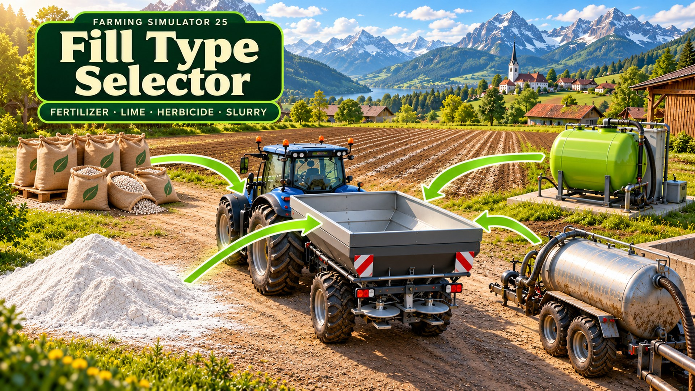
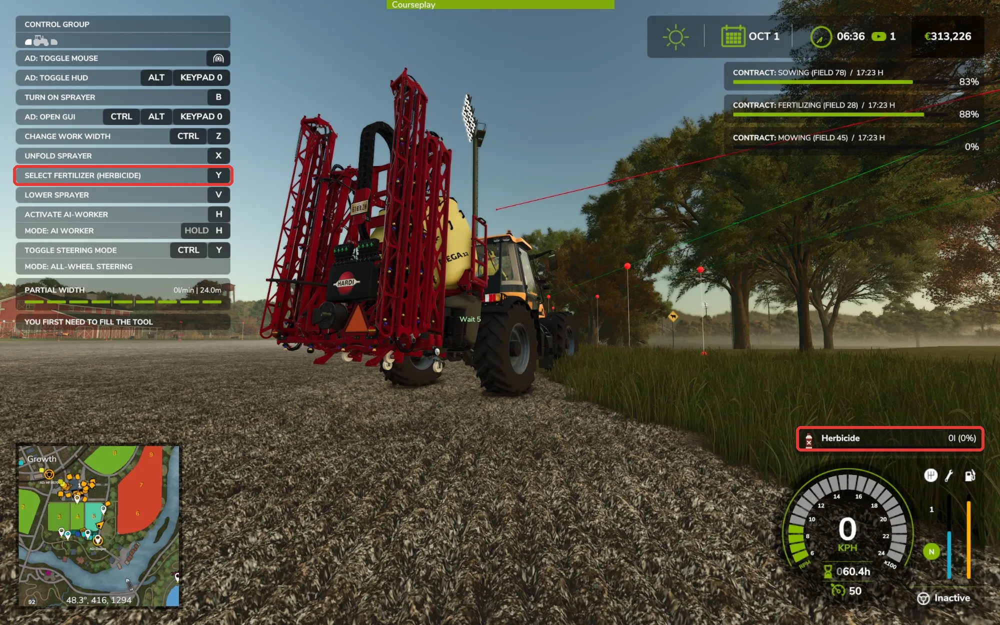
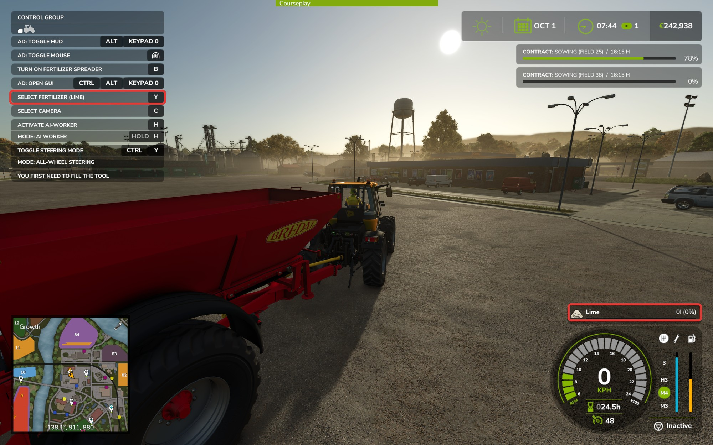

# Fill Type Selector · 肥料选择

  
  
  
  
  

  <a href="#english">English</a> · <a href="#中文">中文</a>

## English

Version 1.0.0.0 · Farming Simulator 25 1.25 (PC)

**Download:** [GitHub releases](https://github.com/martin-lzh/farming-simulator-25-mods/releases/tag/fill-type-selector-v1.0.0.0) (`FS25_FillTypeSelector.zip` under **Assets**) · [Nexus Mods](https://www.nexusmods.com/farmingsimulator25/mods/227)

In the base game, an AI worker with an empty spreader or sprayer picks fertilizer by itself and never lime: a lime-only spreader stops at once, and a spreader for fertilizer and lime always buys fertilizer. With this Mod you choose what an empty fertilizer spreader, sprayer or lime spreader applies, the same way you choose seeds on a seeder, and the worker buys exactly that.

### How to use

1. Get into the tractor with the empty spreader or sprayer attached.
2. Press **Y** to switch between the types the implement can apply; **Shift+Y** goes back. The help (F1) shows **Select fertilizer**, followed by your choice, for example **Select fertilizer (Lime)**. The fill level display of the empty tank shows your choice too.

   

   

3. If the implement or the combination already uses Y, the key is **Alt+Y** and switches forward only. This is the case with a seeder that has several seeds, with Precision Farming, and with a tool carrier or hose reel from the Pumps N' Hoses Pack. To change the key, open Settings → Controls and look for **Select fertilizer (when Y is in use)** under Fill Type Selector.

Implements that can only take one type don't get the key. With two implements attached that both have a choice, the key works on the selected one.

### AI workers and automatic buying

Turn on **AI Worker Refill - Fertilizer** in Settings → Game Settings. A worker with an empty implement then buys the type you chose, lime and herbicide included, at the game's usual refill price. It works only the parts of the field that need that type, for example it skips land that already has lime.

- With the setting off, the worker stops when the tank is empty, as in the base game.
- Lime-only spreaders don't need the key: the worker buys lime for them.
- Manure spreaders that can also spread lime: lime is bought under **AI Worker Refill - Fertilizer**, manure under **AI Worker Refill - Manure**.
- Slurry tankers that take slurry and digestate: choose which of the two the worker uses. With **AI Worker Refill - Slurry** set to **Buy**, the worker buys the chosen type. Set to one of your slurry storages, it takes the chosen type from there first and the other type when that runs out.
- Without a choice, the worker refills as in the base game: sprayers buy liquid fertilizer, spreaders buy fertilizer, slurry tankers use slurry.

### Good to know

- When the tank holds something, that content is used and the choice is locked; the key is hidden. Once the tank is empty again, your choice applies again.
- When an attached tank, such as a front tank, holds something, it is used before your choice, as in the base game.
- You can only choose what the implement is built to spread: fertilizer, liquid fertilizer, lime, herbicide, manure, slurry or digestate. A universal trailer with a manure spreader can load lime but only spreads manure, so lime can't be chosen on it.
- Spreaders that spread lime with a different working width switch to that width when you choose lime, the same as with lime in the tank.
- With the Pumps N' Hoses Pack, manure spreaders can also choose separated manure. The worker buys it when **AI Worker Refill - Manure** is set to **Buy**; with a manure heap set there, it uses manure from the heap instead. Drag hose applicators fed through a hose have nothing to choose.
- AI Worker Refill Split by Joxy replaces **AI Worker Refill - Fertilizer** with separate switches for solid fertilizer, liquid fertilizer, lime and herbicide, for all implements at once. You can use it with this Mod in single player: this Mod decides which type an implement uses, and that Mod's switch for that type decides whether the worker may buy it. Turn on the switch for the type you chose.

### Multiplayer

- Everyone needs the same version of the Mod.
- Players whose farm may use the vehicle can change the choice while the tank is empty and no AI worker is using the implement.
- The choice is shared with all players and saved with the vehicle; players who join later see it too.
- If two players change it at the same moment, the last change applies for everyone.
- Bought fill is charged only once.

### Install and update

For Farming Simulator 25 1.25 on Windows PC. No loader or other Mod is required. In multiplayer, the server and every player use the same Mod version.

1. Close the game before adding or replacing Mod files.
2. Download `FS25_FillTypeSelector.zip` from the [GitHub 1.0.0.0 release](https://github.com/martin-lzh/farming-simulator-25-mods/releases/tag/fill-type-selector-v1.0.0.0): expand **Assets** and choose that file, not **Source code**. Or open the [Nexus page](https://www.nexusmods.com/farmingsimulator25/mods/227), select **Files → Main files → Manual download**, sign in with a free account if asked, then choose **Slow download**.
3. Open **File Explorer** with **Windows + E** and select **Downloads**. Keep the ZIP as it is; do not extract it.
4. In another File Explorer window, select **Documents**, then open **My Games → FarmingSimulator2025 → mods**. If Windows stores Documents in OneDrive, use **OneDrive → Documents**. If `FarmingSimulator2025` does not exist yet, start the game once, reach the main menu and quit; then reopen Documents. If only `mods` is missing, right-click inside `FarmingSimulator2025`, choose **New → Folder**, and name it `mods`.
5. Copy the downloaded ZIP into `mods`. The final path ends in `FarmingSimulator2025\mods\FS25_FillTypeSelector.zip`. Keep only one copy of this Mod.
6. Start the game through your usual launcher, choose your save, and tick **Fill Type Selector** in the Mod list before loading it.
7. Get into a tractor with an empty sprayer or spreader that accepts several types. Press F1: the help shows Select fertilizer.

To update, close the game, download the new ZIP from the same Mod's release page and replace `FS25_FillTypeSelector.zip` in `mods`; your choices are kept.

### Help

If the Mod does not appear, check that the ZIP is in the folder above and ticked for this save. To read the log, return to **Documents → My Games → FarmingSimulator2025**, right-click `log.txt`, choose **Open with → Notepad**, and look for the Mod name or an error. Include the relevant lines and what you did in a [GitHub Issue](https://github.com/martin-lzh/farming-simulator-25-mods/issues/new/choose). More help: [Support](https://github.com/martin-lzh/farming-simulator-25-mods/blob/main/SUPPORT.md#english).

### Uninstall

Close the game and remove `FS25_FillTypeSelector.zip` from the mods folder. Vehicles keep their content, and workers refill as in the base game again.

### License

PolyForm Noncommercial License 1.0.0, see [LICENSE](LICENSE). Free for non-commercial use; commercial use is not allowed.

## 中文

版本 1.0.0.0 · 模拟农场 25 1.25（PC）

**下载：**[GitHub 发布页](https://github.com/martin-lzh/farming-simulator-25-mods/releases/tag/fill-type-selector-v1.0.0.0)（在 **Assets** 下载 `FS25_FillTypeSelector.zip`）· [Nexus Mods](https://www.nexusmods.com/farmingsimulator25/mods/227)

原版中，料箱为空时 AI 帮手会自己挑肥料，却从不选石灰：只能撒石灰的散布机直接停工，能撒肥料和石灰的肥料散布机总是买肥料。装上本 Mod 后，可以像在播种机上选种子一样，为空的肥料散布机、喷洒机或石灰散布机选好要施用的类型，帮手就会买这一种。

### 使用方法

1. 坐进挂着空肥料散布机或喷洒机的拖拉机。
2. 按 **Y** 在机具能施用的类型之间切换，**Shift+Y** 反向切换。帮助（F1）中显示“选择肥料”，后面括号里是当前选择，例如“选择肥料 (石灰)”。空料箱的料量显示也会显示所选类型。

   

   

3. 如果机具或组合已经占用了 Y，按键改为 **Alt+Y**，只能向前切换。可选多种种子的播种机、精准农业，以及 Pumps N' Hoses Pack 的工具架和脐带软管卷筒都属于这种情况。要修改按键，打开“设置 → 控制”，在“肥料选择”下找到“选择肥料（Y 已被占用时）”。

只能装一种类型的机具不会出现此按键。同时挂着两台都能选择的机具时，按键作用于当前选中的那台。

### AI 帮手与自动购买

在“设置 → 游戏设置”中开启“AI 帮手补充 - 肥料”。料箱为空时，帮手会按游戏通常的补充价格购买你选择的类型，包括石灰和除草剂，并且只处理田里需要这种类型的区域，例如跳过已经撒过石灰的地块。

- 关闭该设置时，与原版相同，料箱空了帮手就会停下。
- 只能装石灰的散布机不需要按键，帮手会直接买石灰。
- 也能撒石灰的粪肥散布机：石灰按“AI 帮手补充 - 肥料”购买，粪肥按“AI 帮手补充 - 粪肥”购买。
- 能装水肥和沼渣的水肥罐车：可以选择帮手用哪一种。“AI 帮手补充 - 水肥”设为“购买”时，帮手购买所选类型；设为你的某个水肥储存设施时，先从那里调取所选类型，用完后再用另一种。
- 没有做选择时，帮手按原版方式补充：喷洒机买液态肥料，散布机买固态肥料，水肥罐车用水肥。

### 注意事项

- 料箱里有东西时按实际内容施用，选择被锁定，按键隐藏；料箱再次清空后，你的选择重新生效。
- 与原版相同，连接的额外储罐（例如前罐）里有东西时会先用它，而不是你的选择。
- 只能选择机具本身能施撒的类型：固态肥料、液态肥料、石灰、除草剂、粪肥、水肥或沼渣。带粪肥撒播机的通用拖车虽然能装石灰，但只能撒粪肥，所以不能选石灰。
- 撒石灰时工作宽度不同的散布机，选择石灰后会换成石灰的工作宽度，和料箱里装着石灰时一样。
- 安装 Pumps N' Hoses Pack 时，粪肥散布机还可以选择已分离粪肥。“AI 帮手补充 - 粪肥”设为“购买”时帮手会买它；设为粪肥堆时改用粪肥堆里的粪肥。通过软管供料的拖管施肥机没有可选项。
- Joxy 制作的 AI Worker Refill Split 把“AI 帮手补充 - 肥料”拆成固态肥料、液态肥料、石灰和除草剂四个开关，对所有机具统一生效。单人游戏中可以和本 Mod 一起使用：本 Mod 决定机具用哪种类型，该 Mod 中对应类型的开关决定帮手能否购买。请打开你所选类型对应的开关。

### 多人游戏

- 所有玩家需要安装同一版本。
- 所属农场可以使用该车辆的玩家，可以在料箱为空、且没有 AI 帮手使用该机具时修改选择。
- 选择对所有玩家同步，并随车辆保存；之后加入的玩家也能看到。
- 两位玩家同时修改时，以最后一次修改为准，所有人一致。
- 购买的物料只扣一次款。

### 安装与更新

适用于 Windows PC 版模拟农场 25 1.25，不需要加载器或其他 Mod。多人游戏时，服务器和所有玩家使用同一 Mod 版本。

1. 添加或替换 Mod 文件前，先退出游戏。
2. 打开 [GitHub 1.0.0.0 发布页](https://github.com/martin-lzh/farming-simulator-25-mods/releases/tag/fill-type-selector-v1.0.0.0)，展开 **Assets（附件）**，下载 `FS25_FillTypeSelector.zip`，不要选择 **Source code（源码）**。也可打开 [Nexus 页面](https://www.nexusmods.com/farmingsimulator25/mods/227)，进入 **Files（文件）→ Main files（主要文件）→ Manual download（手动下载）**；提示登录时使用免费账号，随后选择 **Slow download（慢速下载）**。
3. 按 **Windows + E** 打开**文件资源管理器**，点击**下载**。保留 ZIP 原样，不要解压。
4. 在另一个文件资源管理器窗口点击**文档**，依次打开 **My Games → FarmingSimulator2025 → mods**。文档由 OneDrive 管理时，使用 **OneDrive → 文档**。如果还没有 `FarmingSimulator2025`，先启动一次游戏，到主菜单后退出，再打开文档；如果只缺 `mods`，在 `FarmingSimulator2025` 中右键，选择**新建 → 文件夹**，命名为 `mods`。
5. 把下载的 ZIP 复制到 `mods`，最终路径以 `FarmingSimulator2025\mods\FS25_FillTypeSelector.zip` 结尾，同一 Mod 只保留一份。
6. 从平常使用的启动器打开游戏，选择存档，载入前在 Mod 列表中勾选**“肥料选择”**。
7. 坐进挂着空喷洒机或散布机的拖拉机，机具须支持多种类型。按 F1，帮助中会显示“选择肥料”。

更新时先退出游戏，从同一 Mod 的发布页下载新 ZIP，替换 `mods` 中的 `FS25_FillTypeSelector.zip`；原有选择保留。

### 帮助

Mod 没有出现时，检查 ZIP 是否位于上述目录，并确认当前存档已勾选它。查看日志时，回到**文档 → My Games → FarmingSimulator2025**，右键 `log.txt`，选择**打开方式 → 记事本**，查找 Mod 名称或错误。可在 [GitHub Issue](https://github.com/martin-lzh/farming-simulator-25-mods/issues/new/choose) 中附相关几行和操作经过。更多排查见[帮助](https://github.com/martin-lzh/farming-simulator-25-mods/blob/main/SUPPORT.md#中文)。

### 卸载

退出游戏，从 mods 文件夹删除 `FS25_FillTypeSelector.zip`。车辆里的物料不变，帮手恢复按原版方式补充。

### 许可

PolyForm Noncommercial 1.0.0 许可，见 [LICENSE](LICENSE)。可免费用于非商业用途，不允许商用。
