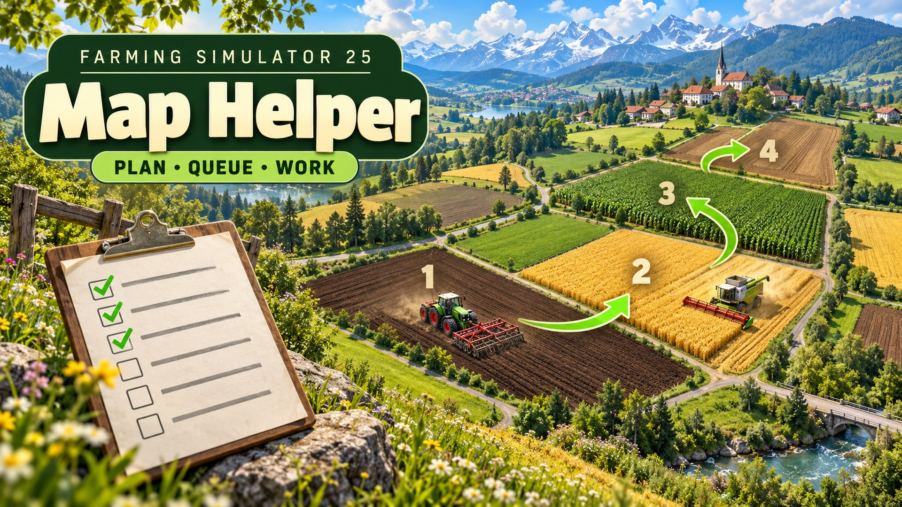

# Map Helper · 地图助手

  
  
  
  

  <a href="#english">English</a> · <a href="#中文">中文</a>

## English

Version 1.0.0.0 · Farming Simulator 25 1.25 (PC)

**Download:** [GitHub releases](https://github.com/martin-lzh/farming-simulator-25-mods/releases?q=map-helper&expanded=true) (`FS25_MapHelper.zip` under **Assets**)

Plan your workers' jobs straight from the map. Map Helper adds a page to the left sidebar of the map. It shows which fields need the work your vehicle can do, sets up jobs with the game's own job settings and keeps them in a to-do list for each vehicle: when one job is done, the next one starts by itself.

### How to use

1. Get into the vehicle you want to plan for and press **Left Alt + M**. The map opens on the Map Helper page. This also works on foot; then click one of your vehicles on the map. If the map is already open, click **Map Helper** in the button bar at the bottom of the screen or press the key shown next to it (X by default).

   <!-- SCREENSHOT assets/screenshots/01-map-button-bar-map-helper.jpg | Map page with Map Helper and its X key in the bottom button bar | 地图页面底部按钮栏中的“地图助手”及其 X 键 -->

2. Check the vehicle card at the top of the page. It shows the vehicle's name, whether a worker is driving it, and whether jobs are waiting or the queue is paused. To plan for another of your vehicles, click it on the map. Click the card to go back to your own vehicle.
3. Choose what the list shows with the selector above it (see [Places](#places)), then click a place. The map moves there and the job below is filled in: a field or contract gets **Fieldwork** there (**GoTo** if the vehicle can't do fieldwork), a station gets **Load and Deliver** or **Deliver**.

   <!-- SCREENSHOT assets/screenshots/02-page-fields-needing-this-work.jpg | Map Helper page with Fields needing this work selected and a field filled in as Fieldwork | 地图助手页面选中“需要此作业的田地”，点击田地后填好田地工作 -->

4. Check the job. These are the game's own job settings, the same as in **Create job**: job type, target and direction (picked on the map), stations, fill type and looping. Then click **Add to queue** (Z) to add it at the end, or **Insert as next** (X) to run it next. If no worker is driving the vehicle, the job starts right away. If something is missing, the game's own warning tells you what.
5. Add more jobs the same way. They wait in the **Command queue** and start one after another.

   <!-- SCREENSHOT assets/screenshots/03-command-queue-with-waiting-jobs.jpg | Command queue with the current job, its distance to the target and three numbered waiting jobs | 指令队列：当前作业及离目标的距离，下面是三个编号的等待作业 -->

Tip: double-click a field or contract to add Fieldwork there in one step.

### Places

| Choice | What the list shows |
| --- | --- |
| Fields needing this work | Your accepted contracts this vehicle can work on, then your own fields that need its work now. Each row names the work. |
| My fields | All your fields with their state, such as Ready to harvest, Growing, Needs lime or Plowed. |
| Contracts | Your accepted field contracts with their progress. Contracts this vehicle can work on come first and name the work. |
| Stations | Where the vehicle can load or deliver. Only offered for vehicles that can do delivery jobs. |

Fields needing this work covers plowing, cultivating, sowing, rolling, fertilizer, lime, herbicide, weeding, mulching, mowing, harvesting, removing foliage and stone picking, depending on the tools attached. A field is only listed when the work can be done now: no lime on a growing crop, sowing only when the selected seed is in season (rice only on rice fields), stone picking only on worked soil, harvesting only crops the header takes. Sprayers count by what is in their tank or front tank.

The page starts with Fields needing this work when it recognises the vehicle's tools, otherwise with My fields. It remembers your choice for each vehicle while you play. Fields you joined by working the strip between them show as one row, such as Field No. 3 + 4 + 5. Places a worker is already working are marked **Worker on it**, places in a queue **Queued**; in Fields needing this work and Contracts they come last.

### Command queue

The job a worker is driving now comes first, with what it is doing, the distance to its target and, on a contract field, the contract's progress. Below it are the waiting jobs, numbered in the order they run. Select a row to:

| Button | What it does |
| --- | --- |
| Arrows | Move a waiting job up or down. |
| Edit | Load a waiting job into the job settings. Change it, then click **Save** (Z), or **Cancel** (X) to keep it as it was. |
| Delete | Remove a waiting job. On the current job it reads **Cancel Job** and stops the worker. |
| Clear queue | Remove all waiting jobs. |

When a job is done, it disappears. The next one starts once the vehicle has stopped and its implements have folded or lifted. You can add, move, edit and delete waiting jobs at any time, also while a worker is driving. If you started the current job yourself, the queue continues after it. A vehicle can have up to 10 waiting jobs.

Fieldwork uses the worker settings the vehicle has when that job starts. If you change them after queueing, the new settings apply.

### If the queue pauses

When you stop a job, or a job can't be finished (for example out of fuel or seed, blocked, or the field isn't ready), the queue pauses. The waiting jobs stay, the card shows the reason and you get a message. Fix the problem, then click **Resume** or add a job: the queue continues with its first waiting job. The queue also pauses when the next job can't start, for example because too many workers are active.

<!-- SCREENSHOT assets/screenshots/04-queue-paused-resume.jpg | Vehicle card showing Queue paused with the reason, and the Resume button next to Command queue | 车辆卡片显示“队列已暂停”及原因，“指令队列”旁显示“继续队列” -->

Queues are saved with the game. After loading, a queue waits until you click **Resume** or add a job. If a worker starts on the vehicle first, for example one who carries on with fieldwork from before you saved, the queue continues after that job.

### Multiplayer

- The server and every player need the same version of the Mod.
- Farm members with the **Hire AI worker** permission can plan and change the queues of their farm's vehicles. Without it, the page says you aren't allowed to hire workers.
- The server runs the queues. They keep going when the player who planned them leaves, and players who join later see them.
- When another player is sitting in the vehicle, the queue can't start a job there and pauses with the reason. Click **Resume** once they have got out.
- Messages about a paused or finished queue go to the members of the vehicle's farm.

### Good to know

- Queued jobs are normal worker jobs (GoTo, Fieldwork, Deliver, Load and Deliver) and cost the same as any hired worker.
- The lists read each field's state at one spot, the same one the game uses for the field's info. When a field is only partly worked, check it on the map before you queue it.
- With an empty sprayer and the Fill Type Selector Mod installed, the list follows the fill type chosen there.
- On the Precision Farming soil map, X opens its Help and the Map Helper entry is hidden; use Left Alt + M or the arrows at the top of the sidebar. The entry is also hidden while you create a job with the game's own **Create job**.
- You can change Left Alt + M in the controls (**Open Map Helper**). The keys are shown on the buttons; controllers have their own default buttons.
- Other Mods that change the map page or the worker menus may not work together with Map Helper; try them in a separate save first.
- Job Queue by 19mariusz95 also queues worker jobs for a vehicle. You can install both, but plan each vehicle's jobs in only one of them: when the same vehicle has jobs waiting in both, Job Queue starts its next job first and Map Helper's queue pauses. Job Queue works in single player only.

### Install and update

Put `FS25_MapHelper.zip` in `Documents\My Games\FarmingSimulator2025\mods` and activate the Mod when you load a save. To update, replace the old ZIP with the new one; your queues are kept.

### Uninstall

Let your queues finish or clear them, save, then remove the ZIP. Without the Mod, the save loads normally and queued jobs no longer run.

### License

PolyForm Noncommercial License 1.0.0, see [LICENSE](LICENSE). Free for non-commercial use; commercial use is not allowed.

## 中文

版本 1.0.0.0 · 模拟农场 25 1.25（PC）

**下载：**[GitHub 发布页](https://github.com/martin-lzh/farming-simulator-25-mods/releases?q=map-helper&expanded=true)（在 **Assets** 下载 `FS25_MapHelper.zip`）

直接在地图上给帮手安排作业。地图助手在地图左侧边栏加入一个页面：列出哪些田地需要你的载具能做的作业，用游戏自带的作业设置安排作业，并为每台载具排成一张待办清单。一个作业完成后，下一个自动开始。

### 使用方法

1. 坐进要安排作业的载具，按 **左 Alt + M**，地图会直接打开地图助手页面。步行时也可以按，然后在地图上点击你的一台载具。如果地图已经打开，点击屏幕底部按钮栏中的 **地图助手**，或按旁边显示的按键（默认为 X）。

   <!-- SCREENSHOT assets/screenshots/01-map-button-bar-map-helper.jpg | Map page with Map Helper and its X key in the bottom button bar | 地图页面底部按钮栏中的“地图助手”及其 X 键 -->

2. 看一下页面顶部的载具卡片：载具名称、是否有帮手在驾驶、是否有作业在等待、队列是否暂停。要为你的其他载具安排作业，在地图上点击那台载具；点击卡片即可回到你自己的载具。
3. 用列表上方的选择器决定列表显示什么（见[地点](#地点)），然后点击一个地点。地图会移到该处，下方的作业随之填好：田地或合同设为在该处 **田地工作**（载具不能做田地工作时设为 **前往**），站点设为 **装载和运送** 或 **运送**。

   <!-- SCREENSHOT assets/screenshots/02-page-fields-needing-this-work.jpg | Map Helper page with Fields needing this work selected and a field filled in as Fieldwork | 地图助手页面选中“需要此作业的田地”，点击田地后填好田地工作 -->

4. 检查作业。这里就是游戏自带的作业设置，与 **创建作业** 中相同：作业类型、目标位置和方向（在地图上选择）、站点、装填类型和循环。然后点击 **加入队列**（Z）排到最后，或点击 **插入为下一个**（X）让它下一个执行。没有帮手驾驶这台载具时，作业会立即开始。缺少什么设置，游戏自带的提示会告诉你。
5. 用同样的方法继续添加。作业在 **指令队列** 中等待，依次自动开始。

   <!-- SCREENSHOT assets/screenshots/03-command-queue-with-waiting-jobs.jpg | Command queue with the current job, its distance to the target and three numbered waiting jobs | 指令队列：当前作业及离目标的距离，下面是三个编号的等待作业 -->

小技巧：双击田地或合同，可以一步把该处的田地工作加入队列。

### 地点

| 选项 | 列表内容 |
| --- | --- |
| 需要此作业的田地 | 先列出这台载具能做的已接合同，再列出你的田地中现在需要它作业的。每一行写明需要的作业。 |
| 我的田地 | 你所有的田地及其状态，例如可以收获、生长中、需要石灰、已犁田。 |
| 合同 | 已接受的田地合同及其进度。这台载具能做的排在前面，并写明作业。 |
| 站点 | 载具可以装货或卸货的地方。只有能执行运送类作业的载具才有这一项。 |

“需要此作业的田地”根据挂接的工具，涵盖犁田、耕耘、播种、碾压、施肥、施石灰、喷除草剂、除草、松土、割草、收割、去除茎叶和除石。只列出现在就能做的田地：生长中的作物不施石灰；所选种子在播种季节内才列出播种（水稻只在稻田）；整过的土地才除石；割台能收的作物才列出收割。喷洒机按药箱或前置药箱里装的东西判断。

页面识别出载具的工具时默认显示“需要此作业的田地”，否则显示“我的田地”；每台载具的选择在本次游戏中会被记住。通过耕作中间地带连成一片的田地显示为一行，例如“田地编号 3 + 4 + 5”。已有帮手在作业的地点标为 **帮手作业中**，在队列中的标为 **已在队列**；在“需要此作业的田地”和“合同”中它们排在最后。

### 指令队列

最上面是帮手正在执行的作业，显示它在做什么、离目标还有多远，在合同田地上还显示合同进度。下面是等待中的作业，按执行顺序编号。选中一行后可以：

| 按钮 | 作用 |
| --- | --- |
| 箭头 | 把等待中的作业上移或下移。 |
| 编辑 | 把等待中的作业载入作业设置。修改后点击 **保存**（Z），或点击 **取消**（X）保持原样。 |
| 删除 | 删除等待中的作业。选中当前作业时显示为 **取消作业**，让帮手停下。 |
| 清空队列 | 删除所有等待中的作业。 |

作业完成后从列表中消失。载具停稳、工具折叠或升起完毕后，下一个作业开始。等待中的作业随时可以添加、移动、编辑和删除，帮手驾驶时也可以。当前作业即使是你自己直接开始的，结束后队列也会继续。每台载具最多可有 10 个等待中的作业。

田地工作使用该作业开始时载具的帮手设置。加入队列后再修改设置，开始时按新设置执行。

### 队列暂停时

你停止了作业，或作业无法完成（例如燃料或种子用完、被挡住、田地未准备好）时，队列会暂停：等待中的作业保留，卡片显示原因，并弹出提示。解决问题后点击 **继续队列** 或加入一个作业，队列从第一个等待中的作业继续。下一个作业无法开始时（例如活跃帮手太多），队列同样会暂停。

<!-- SCREENSHOT assets/screenshots/04-queue-paused-resume.jpg | Vehicle card showing Queue paused with the reason, and the Resume button next to Command queue | 载具卡片显示“队列已暂停”及原因，“指令队列”旁显示“继续队列” -->

队列随存档保存。读档后，队列会等你点击 **继续队列** 或加入作业。如果在此之前载具上已有帮手开始工作（例如接着做存档前田地工作的帮手），队列会在这个作业结束后继续。

### 多人游戏

- 服务器和所有玩家需要安装同一版本的 Mod。
- 有 **雇佣 AI 帮手** 权限的农场成员可以安排和修改本农场载具的队列。没有这个权限时，页面会提示你没有“雇佣 AI 帮手”的权限。
- 队列由服务器执行：安排队列的玩家离开后队列照常进行，之后加入的玩家也能看到。
- 其他玩家坐在车里时，队列无法在这台载具上开始作业，会暂停并显示原因。等对方下车后点击 **继续队列**。
- 队列暂停或完成的提示只发给载具所属农场的成员。

### 注意事项

- 队列中的作业就是游戏自带的帮手作业（前往、田地工作、运送、装载和运送），费用与平时雇佣帮手相同。
- 列表在每块田地的一个点读取状态，这个点与游戏田地信息使用的相同。田地只完成了一部分时，加入队列前请先在地图上看一下。
- 喷洒机药箱为空、又安装了肥料选择（Fill Type Selector）Mod 时，列表按在肥料选择中选定的类型判断。
- 在精准农业的土壤图层上，X 会打开它的“帮助”，底部的“地图助手”也会隐藏；请按左 Alt + M，或用边栏顶部的箭头翻到地图助手页面。用游戏自带的 **创建作业** 创建作业时，这一项同样隐藏。
- 左 Alt + M 可在控制设置中更改（**打开地图助手**）。按键显示在按钮上，手柄有自己的默认按键。
- 修改地图页面或帮手菜单的其他 Mod 可能无法与地图助手共用，请先在单独的存档中试用。
- 19mariusz95 制作的 Job Queue 同样可以为载具排列帮手作业。两个 Mod 可以同时安装，但每台载具只在其中一个里安排作业：同一台载具在两边都有等待的作业时，Job Queue 会先开始它的下一个作业，地图助手的队列则会暂停。Job Queue 只支持单人游戏。

### 安装与更新

把 `FS25_MapHelper.zip` 放进 `文档\My Games\FarmingSimulator2025\mods`，载入存档时勾选本 Mod。更新时用新 ZIP 替换旧 ZIP，原有队列保留。

### 卸载

让队列执行完或将其清空，保存后再删除 ZIP。没有本 Mod 时存档照常载入，队列中的作业不会再执行。

### 许可

PolyForm Noncommercial 1.0.0 许可，见 [LICENSE](LICENSE)。可免费用于非商业用途，不允许商用。
