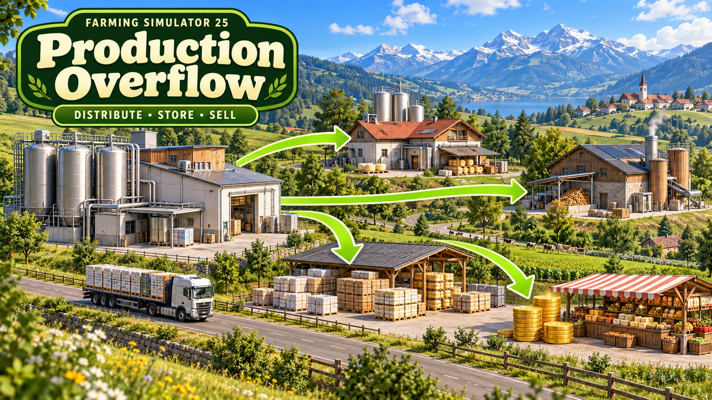
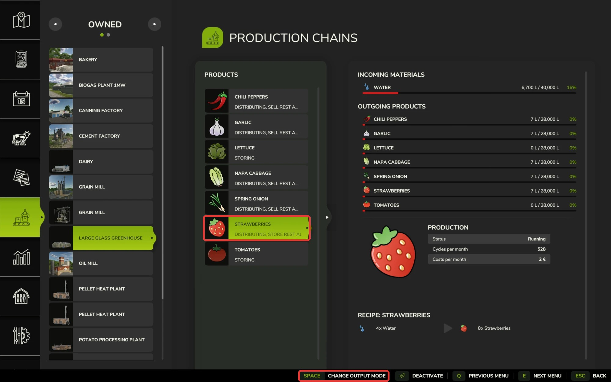
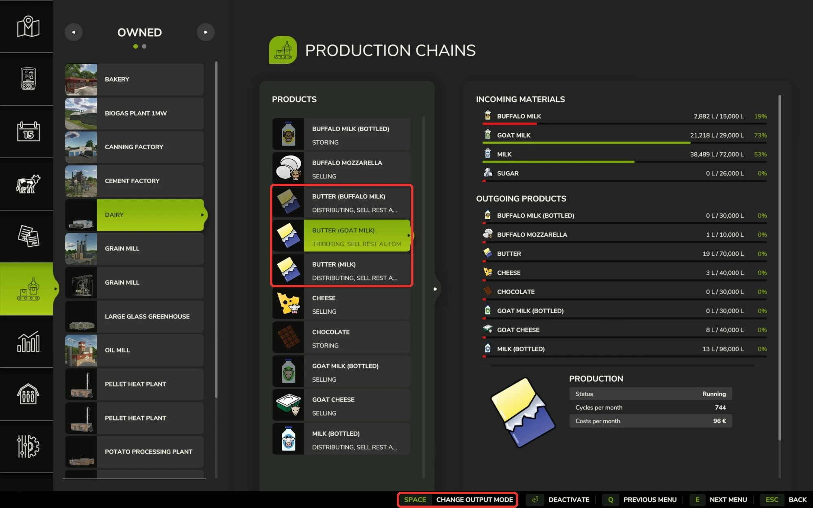

# Production Overflow · 生产余量处理

  
  
  
  
  

  <a href="#english">English</a> · <a href="#中文">中文</a>

## English

Version 1.0.0.0 · Farming Simulator 25 1.25 (PC)

**Download:** [GitHub releases](https://github.com/martin-lzh/farming-simulator-25-mods/releases?q=production-overflow&expanded=true) (`FS25_ProductionOverflow.zip` under **Assets**) · [Nexus Mods](https://www.nexusmods.com/farmingsimulator25/mods/228)

A factory set to Distributing delivers its products to your other production points once per in-game hour. When those are full, the rest stays in the factory, its storage fills up and production stops. This Mod adds two output modes that deal with that rest: turn it into pallets, or sell it.

### How to use

1. Open the in-game menu and go to **Production Chains**.
2. Select your production point, then the production whose output you want to change.
3. Press **Change output mode** until the mode you want is shown, as in the base game. After Distributing come the two new modes, then Storing again. The product list shows the chosen mode by name.

   

| Mode | What happens |
| --- | --- |
| Storing | Same as the base game: the product stays in the factory, and products that come out on pallets become pallets. |
| Selling | Same as the base game: once per in-game hour, the stock is sold at 90% of the current price. |
| Distributing | Same as the base game: once per in-game hour, the stock goes to your farm's production points that accept it, split by their free space, with the game's delivery fee. The rest stays in the factory. |
| Distributing, store rest automatically | Delivers the same way. Then the rest becomes full pallets, as in Storing. |
| Distributing, sell rest automatically | Delivers the same way. Then the rest is sold at the same price as Selling. |

If none of your production points accepts the product, the whole stock becomes pallets or is sold.

### Good to know

- Distributing, store rest automatically is only offered for products that come out on pallets. For other products, such as liquids you pick up at the factory, the button goes from Distributing straight to Distributing, sell rest automatically.
- Selling and making pallets happen once per in-game hour, right after the delivery. When a factory fills up between two full hours, it pauses until the next delivery, as with Distributing in the base game.
- Store rest makes full pallets only. A smaller rest stays in the factory and is delivered first in the next hour. Products made during the hour also wait for the next delivery before they become pallets.
- When the pallet area is blocked or the pallet limit is reached, the waiting pallets appear once there is space again.
- Sell rest also sells products that have no sale price, the same as Selling: the rest is removed and you get nothing for it. To keep such a product, use store rest or Storing.
- Only the factory's own stock is handled, as with Distributing. Pallets already on the ground are not touched.
- The modes stay when a production point changes owner, like the game's own modes. After you switch to store rest, or after the owner changes, the first pallets come after the next in-game hour.
- The Pumps n' Hoses biogas productions keep their own distribution and don't get the new modes.
- Other Mods that change how production points handle their output may not work together with this one. Try them in a separate save first.
- Distribution Redux by Bones replaces the game's hourly distribution with its own and has its own "Distribute + Sell" and "Distribute + Store" modes. It takes over the distribution that this Mod's modes build on, so the two don't work together: with both installed, this Mod's modes do nothing and **Change output mode** follows Distribution Redux. Use one or the other.

### Multiplayer

- Everyone needs the same version of the Mod.
- Farm members with the **Manage Production Points** permission can change the modes. A new mode can take a moment to appear after you press the button.
- If two players change the same product at the same moment, the change the server receives last applies for everyone.
- Modes are saved with the production point, and players who join later receive them.
- Only the server sells and makes pallets, so nothing is counted twice.

### Install and update

Put `FS25_ProductionOverflow.zip` in `Documents\My Games\FarmingSimulator2025\mods` and activate the Mod when you load a save. To update, replace the old ZIP with the new one; your modes are kept.

### Uninstall

Nothing to prepare. Without the Mod, outputs set to one of the new modes use Distributing, and the stock stays in the factory.

### License

PolyForm Noncommercial License 1.0.0, see [LICENSE](LICENSE). Free for non-commercial use; commercial use is not allowed.

## 中文

版本 1.0.0.0 · 模拟农场 25 1.25（PC）

**下载：**[GitHub 发布页](https://github.com/martin-lzh/farming-simulator-25-mods/releases?q=production-overflow&expanded=true)（在 **Assets** 下载 `FS25_ProductionOverflow.zip`）· [Nexus Mods](https://www.nexusmods.com/farmingsimulator25/mods/228)

设为“分配”的工厂每游戏小时把产品送往你自己的其他生产点。这些生产点满了以后，剩余产品留在工厂，工厂仓储也会装满，生产随之停止。本 Mod 新增两种输出模式来处理这部分剩余：生成托盘，或者卖掉。

### 使用方法

1. 打开游戏菜单，进入“生产链”。
2. 选择你的生产点，再选择要修改产出的那项生产。
3. 与原版一样，按“更改输出模式”，直到显示想要的模式。“分配”之后依次是两个新模式，然后回到“储存”。产品列表会显示所选模式的名称。

   

| 模式 | 效果 |
| --- | --- |
| 储存 | 与原版相同：产品留在工厂，以托盘产出的产品生成托盘。 |
| 出售 | 与原版相同：每游戏小时按当前价格的 90% 卖出库存。 |
| 分配 | 与原版相同：每游戏小时把库存送往本农场接收该产品的生产点，按各自空余容量分配，按原版规则收取运费；剩余部分留在工厂。 |
| 分配，剩余自动储存 | 同样分配，之后剩余部分按“储存”生成满托盘。 |
| 分配，剩余自动出售 | 同样分配，之后剩余部分按“出售”的价格卖出。 |

本农场没有生产点接收该产品时，全部库存都会生成托盘或卖出。

### 注意事项

- “分配，剩余自动储存”只对以托盘产出的产品提供。其他产品（例如在工厂装取的液体）按按钮时会从“分配”直接切到“分配，剩余自动出售”。
- 出售和生成托盘在每游戏小时分配之后进行。工厂在两个整点之间装满时，与原版“分配”一样，会暂停到下一次分配。
- 剩余自动储存只生成满托盘；不足一个托盘的余量留在工厂，下一小时优先分配。这一小时内新产出的产品也要先等下一次分配，之后才会生成托盘。
- 托盘生成区被挡住或达到托盘数量上限时，待生成的托盘会在有空位后出现。
- 与“出售”一样，剩余自动出售也会卖出没有售价的产品：剩余部分被清空，没有收入。想保留这类产品，请改用剩余自动储存或“储存”。
- 与“分配”一样，只处理工厂自身的库存；地上已有的托盘不受影响。
- 与原版模式一样，生产点更换所有者后模式保留。刚切换到剩余自动储存或更换所有者后，要等到下一游戏小时才会开始生成托盘。
- Pumps n' Hoses 扩展包的沼气生产保留其自身的分配方式，不提供新模式。
- 其他修改生产点产出处理方式的 Mod 可能无法与本 Mod 共用，请先在单独的存档中试用。
- Bones 制作的 Distribution Redux 用自己的分配取代了游戏每小时的分配，并自带“Distribute + Sell”和“Distribute + Store”模式。它接管了本 Mod 两种模式所依赖的分配，所以两个 Mod 不能一起使用：同时安装时本 Mod 的模式不起作用，“更改输出模式”会按 Distribution Redux 的顺序切换。请二选一。

### 多人游戏

- 所有玩家需要安装同一版本。
- 有“管理生产点”权限的农场成员可以修改模式。按下按钮后，新模式可能要稍等片刻才会显示。
- 两位玩家同时修改同一产品时，以服务器最后收到的修改为准，所有人一致。
- 模式随生产点保存，之后加入的玩家也会同步。
- 出售和生成托盘只由服务器处理，不会重复结算。

### 安装与更新

把 `FS25_ProductionOverflow.zip` 放进 `文档\My Games\FarmingSimulator2025\mods`，载入存档时勾选本 Mod。更新时用新 ZIP 替换旧 ZIP，原有模式保留。

### 卸载

无需准备。卸载后，设为新模式的产出改为“分配”，库存留在工厂。

### 许可

PolyForm Noncommercial 1.0.0 许可，见 [LICENSE](LICENSE)。可免费用于非商业用途，不允许商用。
